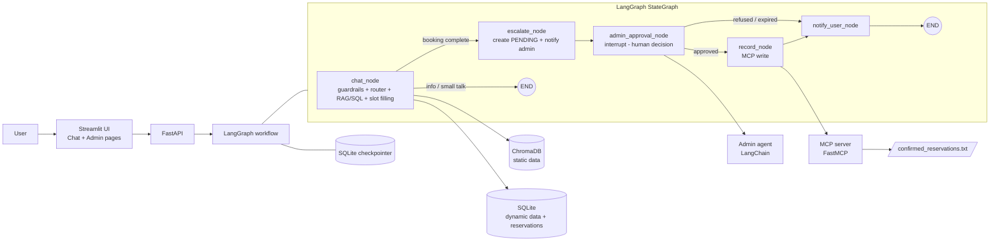
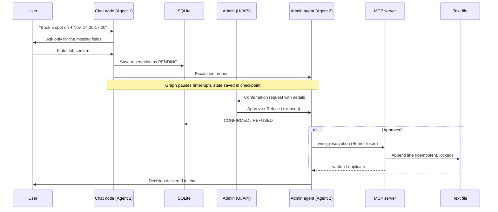
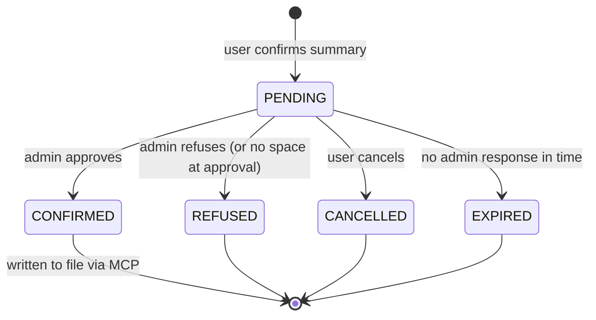

# CityPark RAG Chatbot (Stage-4)

A parking-reservation assistant built in four stages: a RAG chatbot, a human-in-the-loop administrator agent, an MCP server that records approved reservations, and a LangGraph workflow that orchestrates all of them.

## Table of Contents

1. [Overview](#overview)
2. [Architecture](#architecture)
3. [Components](#components)
4. [Reservation Lifecycle](#reservation-lifecycle)
5. [Project Structure](#project-structure)
6. [Setup](#setup)
7. [Configuration](#configuration)
8. [Running the System](#running-the-system)
9. [API Reference](#api-reference)
10. [MCP Server](#mcp-server)
11. [Testing](#testing)
12. [Evaluation and Load Tests](#evaluation-and-load-tests)
13. [Docker, CI/CD and Terraform](#docker-cicd-and-terraform)
14. [Security](#security)
15. [Example Conversations](#example-conversations)
16. [Troubleshooting](#troubleshooting)
17. [Limitations and Future Work](#limitations-and-future-work)

---

## Overview

| Stage | Deliverable |
|---|---|
| 1 | RAG chatbot with a vector DB (static data), SQL DB (dynamic data), reservation slot filling, PII guardrails and an evaluation report |
| 2 | Second LangChain agent that escalates reservation requests to an administrator and returns the approve/refuse decision to the user |
| 3 | MCP server that writes approved reservations to a text file |
| 4 | LangGraph orchestration of the full pipeline, integration tests and load tests |

**Key features**

- Answers questions about location, rules, booking process, EV charging and more using retrieval-augmented generation.
- Answers dynamic questions (availability, prices, working hours) from SQL, never from the LLM's memory.
- Collects reservation details in natural language. Details given in a single message are parsed at once, and only missing fields are asked for.
- Detects and masks sensitive data (emails, phones, card numbers, API keys, passwords) in input and output with Presidio and spaCy. It also blocks prompt-injection attempts.
- Escalates each reservation to a human administrator, who approves or refuses it in the admin panel.
- Writes approved reservations to a text file through an authenticated MCP server.
- Runs offline with a MockLLM fallback when no LLM key is configured.

---

## Architecture



### End-to-end sequence



---

## Components

### 1. RAG chatbot (Agent 1)

- **Static data** (general info, location, rules, booking process, payments, security, EV charging, accessibility, FAQ, cancellation policy) lives in `data/static/*.md`. It is chunked, embedded and stored in ChromaDB.
- **Dynamic data** (availability, prices, working hours, reservations) lives in SQLite and is accessed through SQLAlchemy.
- **Intent router** classifies each message as static info, dynamic info, reservation, small talk or out of scope, using an LLM classifier with a keyword/regex fallback.
- **Dynamic answers** fetch rows from SQL and pass them to the LLM as context. The LLM never invents numbers.
- **Slot extractor** parses name, plate, lot, date, start/end time and duration from free text (for example "4th nov 2026 from 2pm for 3hrs").
- **Guardrails** run on input and output (PII masking, prompt-injection check, leakage blocking). Only the masked text reaches logs and LLM prompts.

### 2. Administrator agent (Agent 2)

- Built with LangChain, with tools to list pending reservations, read details, check availability, send notifications and record decisions.
- Generates a concise confirmation request for the administrator. All facts and numbers come from tool results.
- Accepts natural-language admin commands such as `approve 12`, `refuse 12 because the lot is closed`, or `show pending`.
- **The LLM can never approve on its own.** Only an explicit admin decision changes a reservation's status.
- Channels: REST (default, via the admin API and panel) and optional email with signed, single-use, expiring approve/refuse links.

### 3. MCP server

- Built with the official Python `mcp` SDK (FastMCP, streamable HTTP).
- Tool `write_reservation` appends one line per approved reservation. Tool `list_confirmed_reservations` is read-only.
- Protected by bearer token auth, input validation, injection filtering, rate limiting and file locking. See [MCP Server](#mcp-server).

### 4. LangGraph orchestration

- One `StateGraph` connects the chat, escalation, approval, recording and notification nodes. Existing modules are reused as node functions.
- Human approval uses `interrupt()`. The workflow is resumed with the admin's decision.
- A SQLite checkpointer (`thread_id = session_id`) keeps state across restarts.
- If the MCP server is down, the reservation stays `CONFIRMED` with `file_written = false`, and a retry worker writes it later.

---

## Reservation Lifecycle



- A `PENDING` reservation does not reduce available spaces. Spaces are decremented only on approval.
- On approval, conflicts and availability are re-checked. If there is no space, the reservation is auto-refused with a reason.
- Only `PENDING` reservations can be approved or refused, so a double click cannot double-book.
- Only `CONFIRMED` reservations are ever written to the file.

---

## Project Structure

```
parking-rag-chatbot/
├── app/
│   ├── api/
│   │   ├── main.py                 # FastAPI app, middleware, startup
│   │   └── routes/                 # chat, reservations, admin, graph
│   ├── agents/                     # admin agent, contracts, message bus, channels, MCP client
│   ├── chat/                       # conversation manager, intent router, slot extractor, reservation flow
│   ├── core/                       # config, logging
│   ├── db/                         # models, session, repository
│   ├── guardrails/                 # PII filter, injection check, output filter
│   ├── mcp_server/                 # FastMCP server
│   ├── orchestration/              # LangGraph state, nodes, graph
│   ├── rag/                        # embedder, chroma store, ingestor, retriever, generator
│   └── ui/                         # Streamlit app (Chat + Admin pages)
├── data/
│   ├── static/                     # knowledge base (markdown)
│   ├── eval/                       # evaluation datasets
│   └── output/                     # confirmed_reservations.txt (git-ignored)
├── docs/                           # evaluation and load-test reports, charts, presentations
├── infra/                          # Terraform
├── load/                           # load test scripts
├── scripts/                        # ingest, seed, eval, MCP runner, retry worker
├── tests/                          # unit and integration tests
├── docker-compose.yml
├── Dockerfile
├── pytest.ini
├── requirements.txt
└── .env.example
```

> Folder names reflect the intended layout. If your tree differs slightly, adjust this section.

---

## Setup

**Requirements:** Python 3.11, Git. Docker is optional.

```powershell
git clone <your-repo-url>
cd parking-rag-chatbot

python -m venv venv
venv\Scripts\activate            # Linux/macOS: source venv/bin/activate

pip install -r requirements.txt
python -m spacy download en_core_web_lg

copy .env.example .env           # Linux/macOS: cp .env.example .env
```

Edit `.env` (see [Configuration](#configuration)). Generate strong secrets with:

```
python -c "import secrets; print(secrets.token_urlsafe(32))"
```

Prepare the data:

```
python scripts/seed_db.py
python scripts/ingest.py
```

Use `python scripts/ingest.py --reset` to rebuild the vector store from scratch.

If you already have an older `parking.db` from before Stage 2, delete it and re-run `seed_db.py` (the schema has new tables and columns).

---

## Configuration

All settings come from `.env`. Never commit it. Only `.env.example` (placeholders) belongs in the repo.

| Variable | Purpose | Example / default |
|---|---|---|
| `DIAL_API_KEY` | EPAM DIAL key. Leave empty to run offline with MockLLM | `your-dial-api-key` |
| `DIAL_ENDPOINT` | DIAL endpoint | `https://ai-proxy.lab.epam.com` |
| `DIAL_API_VERSION` | DIAL API version | `2025-04-01-preview` |
| `DIAL_CHAT_MODEL` | Chat model deployment name | `your-chat-model` |
| `DIAL_EMBEDDING_MODEL` | Embedding deployment name | `text-embedding-3-small-1` |
| `OPENAI_API_BASE`, `OPENAI_API_KEY`, `OPENAI_MODEL` | Optional OpenAI-compatible alternative | commented out |
| `LLM_TEMPERATURE` | Sampling temperature | `0.1` |
| `LLM_TIMEOUT` | LLM request timeout (s) | `30.0` |
| `LLM_MAX_RETRIES` | LLM retries with backoff | `3` |
| `EMBEDDING_MODEL` | Local sentence-transformers model | `all-MiniLM-L6-v2` |
| `CHROMA_PERSIST_DIR` | Vector store folder | `./chroma_db` |
| `CHROMA_COLLECTION` | Chroma collection name | `parking_static` |
| `DATABASE_URL` | SQLAlchemy URL | `sqlite:///./parking.db` |
| `RETRIEVAL_TOP_K` | Chunks retrieved per query | `5` |
| `APP_HOST`, `APP_PORT` | API bind address | `127.0.0.1`, `8000` |
| `LOG_LEVEL` | Logging level | `INFO` |
| `API_BASE_URL` / `ADMIN_API_BASE_URL` | API URL used by the UI | `http://localhost:8000` |
| `ADMIN_API_KEY` | Key for `X-Admin-Key` header | generate a strong value |
| `ADMIN_EMAIL_ENABLED` | Enable the email channel | `false` |
| `SMTP_HOST`, `SMTP_PORT`, `SMTP_USER`, `SMTP_PASSWORD` | SMTP settings | `localhost`, `1025` |
| `ADMIN_EMAIL`, `EMAIL_FROM` | Email addresses | placeholders |
| `EMAIL_TOKEN_SECRET` | Signs approve/refuse links | generate a strong value |
| `EMAIL_TOKEN_MAX_AGE_SECONDS` | Link lifetime | `86400` |
| `MCP_HOST`, `MCP_PORT` | MCP server bind address | `127.0.0.1`, `8765` |
| `MCP_API_KEY` | Bearer token (min. 16 chars), same for server and client | generate a strong value |
| `RESERVATIONS_FILE` | Output file path (server-side only) | `data/output/confirmed_reservations.txt` |
| `MCP_RATE_LIMIT_PER_MINUTE` | Server rate limit | `120` |
| `MCP_EXPORT_ENABLED` | Write to the file after approval | `true` |
| `MCP_SERVER_URL` | MCP endpoint used by the client | `http://127.0.0.1:8765/mcp` |
| `MCP_CLIENT_TIMEOUT` | Client timeout (s) | `5.0` |
| `MCP_CLIENT_MAX_ATTEMPTS` | Client retries | `3` |
| `MCP_CLIENT_BACKOFF_SECONDS` | Backoff base | `0.5` |
| `MCP_RETRY_INTERVAL_SECONDS` | Retry worker interval | `60` |
| `GRAPH_CHECKPOINT_DB` | LangGraph checkpoint database | `./data/checkpoints.sqlite` |
| `APPROVAL_EXPIRY_HOURS` | Hours before a pending request expires | `24` |

> The last two variables are Stage 4 additions. Confirm the names match `app/core/config.py`.

---

## Running the System

Start three processes, each in its own terminal (with the venv activated):

```
# 1. MCP server
python scripts/run_mcp_server.py

# 2. API
uvicorn app.api.main:app --reload

# 3. UI (chat + admin panel)
streamlit run app/ui/streamlit_app.py
```

| Service | URL |
|---|---|
| Streamlit UI | http://localhost:8501 |
| API docs (Swagger) | http://localhost:8000/docs |
| API health | http://localhost:8000/health |
| MCP server | http://127.0.0.1:8765/mcp |

**Using the UI**

1. Open the **Chat** page and book a spot. The request goes to `PENDING`.
2. Use the sidebar to switch to the **Admin Panel**, enter the `ADMIN_API_KEY` and approve or refuse the request.
3. Return to **Chat**. The decision appears as a message.
4. Check `data/output/confirmed_reservations.txt` for the new line.

**Retry failed writes manually** (if the MCP server was down during an approval):

```
python scripts/retry_pending_writes.py
```

---

## API Reference

Admin endpoints require the header `X-Admin-Key: <ADMIN_API_KEY>`.

### Public

| Method | Path | Description |
|---|---|---|
| GET | `/health` | Health check |
| GET | `/lots` | Parking lots with live availability |
| POST | `/chat` | Send a message: `{session_id, message}` returns `{answer, sources, intent, guardrail_flags}` |
| POST | `/reset-session` | Clear a chat session |
| GET | `/reservations/{id}/status` | Reservation status, reason, decision time |
| GET | `/sessions/{session_id}/notifications` | Undelivered admin decisions for a session |

### Admin (protected)

| Method | Path | Description |
|---|---|---|
| GET | `/admin/verify` | Validate the API key |
| GET | `/admin/reservations/pending` | Pending reservations |
| GET | `/admin/reservations/history` | Decided reservations (optional status filter) |
| GET | `/admin/reservations/{id}` | Reservation details |
| POST | `/admin/reservations/{id}/approve` | Approve `{note?}`. Returns `file_written` flag |
| POST | `/admin/reservations/{id}/refuse` | Refuse `{reason}` |
| POST | `/admin/chat` | Natural-language commands to the admin agent |
| GET | `/admin/approve?token=...` | Email-link approval (signed, single use) |
| GET | `/admin/refuse?token=...` | Email-link refusal (signed, single use) |
| GET | `/graph/{session_id}/state` | Workflow state for debugging |

### curl examples

```bash
# Chat
curl -X POST http://localhost:8000/chat \
  -H "Content-Type: application/json" \
  -d '{"session_id":"demo1","message":"What are your opening hours?"}'

# List pending reservations
curl http://localhost:8000/admin/reservations/pending \
  -H "X-Admin-Key: $ADMIN_API_KEY"

# Approve
curl -X POST http://localhost:8000/admin/reservations/1/approve \
  -H "X-Admin-Key: $ADMIN_API_KEY" -H "Content-Type: application/json" \
  -d '{"note":"OK"}'

# Refuse
curl -X POST http://localhost:8000/admin/reservations/2/refuse \
  -H "X-Admin-Key: $ADMIN_API_KEY" -H "Content-Type: application/json" \
  -d '{"reason":"Lot closed for maintenance"}'
```

On Windows PowerShell, use `$env:ADMIN_API_KEY` and `curl.exe`, or call the Swagger UI at `/docs`.

---

## MCP Server

**Tools**

| Tool | Description |
|---|---|
| `write_reservation(reservation_id, customer_name, car_plate, start_time, end_time, approved_at)` | Appends one line. Returns `written` or `duplicate` |
| `list_confirmed_reservations(limit)` | Read-only listing |

**Output file format** (`Name | Car Number | Reservation Period | Approval Time`):

```
Name | Car Number | Reservation Period | Approval Time
Shalini Singh | TS09AB1234 | 2026-11-04 14:00 - 17:00 | 2026-11-03 11:30:00
```

**Reliability**

- Idempotent: the same reservation ID is never written twice.
- Atomic appends with a file lock, so concurrent writes do not interleave.
- If the server is unreachable, the approval stays committed, the reservation is flagged `file_written = false`, and the retry worker writes it later.

---

## Testing

```
# All tests
python -m pytest -v

# With coverage
python -m pytest --cov=app --cov-report=term-missing

# HTML coverage report (open htmlcov/index.html)
python -m pytest --cov=app --cov-report=html
```

Tests use a mocked LLM, temporary SQLite and Chroma directories, and no network calls. Test groups: configuration, DB and repository, RAG pipeline, router and slot extraction, reservation flow, guardrails, API, admin agent, channels, MCP server and client, LangGraph workflow, and end-to-end integration (`tests/integration/`).

---

## Evaluation and Load Tests

**RAG evaluation** (Recall@K, Precision@K, MRR, hit rate, latency, guardrail precision/recall):

```
python scripts/run_eval.py
```

Output: `docs/evaluation_report.md`, `docs/results.json`, `docs/charts/`.

**Load tests** (chatbot dialogue, admin approvals, MCP recording):

```
python load/load_test.py
```

Output: `docs/load_test_report.md`. The tests also verify that the output file has no lost or duplicated lines and that there are no double bookings.

> Add your measured results here after running the scripts (average and p95 latency, throughput, error rate).

---

## Docker, CI/CD and Terraform

```
docker compose up --build
docker compose down
```

Services: `api`, `ui`, `mcp-server` (internal network only), with volumes for SQLite, Chroma, the checkpoint DB and `data/output`. Optional `mailpit` profile for local email testing.

- **CI** (`.github/workflows/ci.yml` or `.gitlab-ci.yml`): ruff lint, pytest with `--cov-fail-under=85`, Docker build.
- **Terraform** (`infra/`): container deployment with sensitive variables for all secrets.

---

## Security

- **Secrets** are read from `.env` only. `.env`, databases, checkpoint files and `data/output/*.txt` are git-ignored.
- **Admin API** requires `X-Admin-Key` (constant-time comparison). Email links use signed, expiring, single-use tokens.
- **MCP server** requires a bearer token, binds to `127.0.0.1` by default, ignores any client-supplied file path, validates every field, rejects `|`, CR/LF and control characters to prevent line injection, and applies a rate limit.
- **PII protection:** names, plates, emails, phones, cards, keys and passwords are masked in logs and LLM prompts. Raw values are never logged.
- **LLM boundaries:** the LLM cannot approve reservations or trigger file writes. Only an explicit admin decision does.
- **Prompt injection:** attempts such as "ignore previous instructions" get a safe refusal.

---

## Example Conversations

**Booking with all details in one message**

```
User: Hi
Bot:  Hello! I'm the CityPark assistant. How can I help?
User: My name is Shalini Singh, I want to book a spot for 4th Nov 2026 from 2pm for 3 hours
Bot:  Thanks Shalini! I have 4 Nov 2026, 14:00-17:00. Which lot, and what is your car plate number?
User: Central lot, TS09AB1234
Bot:  Summary: ... Please confirm (yes/no).
User: yes
Bot:  Your request #12 has been sent to the administrator. I'll let you know the decision.
...
Bot:  Good news! Reservation #12 is confirmed for 4 Nov 2026, 14:00-17:00.
```

**Refusal**

```
Bot:  Reservation #13 was not approved: "Lot closed for maintenance".
      Would you like to try another time or lot?
```

---
