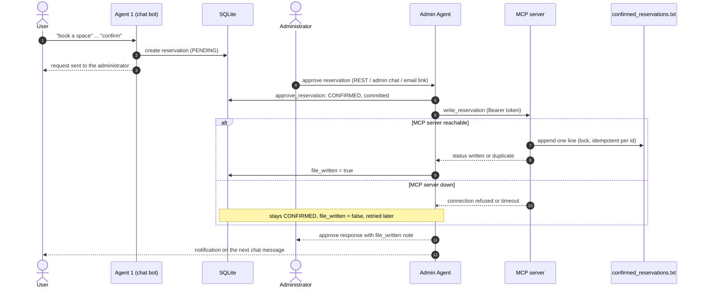

# CityPark RAG Chatbot — Stage 3

A RAG-powered parking reservation assistant with a **human-in-the-loop approval workflow**
whose approved reservations are written to a file through an **MCP server**,
built with FastAPI, LangChain, ChromaDB, SQLite, and Streamlit.

---

## Architecture overview

```
User (browser)
  |-- POST /chat ─────────────────────> FastAPI  (app/api/routes/chat.py)
                                           |
                                    Agent 1: RAG Chatbot
                                    (app/chat/reservation.py)
                                           |  user confirms booking
                                    create_pending_reservation()
                                           |
                                    ChannelRegistry
                                      RestChannel (always)
                                      EmailChannel (if ADMIN_EMAIL_ENABLED)
                                           |
                                    Admin sees pending in:
                                      GET /admin/reservations/pending
                                      Admin Panel page in Streamlit UI (:8501/admin)
                                           |
                               Admin approves or refuses
                               POST /admin/reservations/{id}/approve
                               POST /admin/reservations/{id}/refuse
                               POST /admin/chat  (natural language)
                               GET  /admin/approve?token=...  (email link)
                               GET  /admin/refuse?token=...   (email link)
                                           |
                                    Agent 2: AdminAgent (LangChain)
                                    (app/agents/admin_agent.py)
                                           |
                                    User's next message delivers notification
                                    GET /sessions/{id}/notifications (poll)
                                           |
                                    On approval only (Stage 3): MCP server
                                    appends the reservation to a text file
                                    (see "Stage 3" below)
```

---

## Quick start (local)

```bash
# 1. Create and activate virtual environment
python -m venv .venv
source .venv/bin/activate          # Windows: .venv\Scripts\activate

# 2. Install dependencies
pip install -r requirements.txt
python -m spacy download en_core_web_lg

# 3. Configure environment
cp .env.example .env
# Edit .env — set ADMIN_API_KEY and (optionally) OPENAI_API_KEY

# 4. Seed DB, apply Stage-2 migration, ingest documents
python scripts/seed_db.py
python scripts/migrate_stage2.py
CHROMA_COLLECTION=parking_static python scripts/ingest.py

# 5. Start the API
uvicorn app.api.main:app --reload --port 8000

# 6. Start the unified UI (Chat + Admin Panel via sidebar)
streamlit run app/ui/streamlit_app.py --server.port 8501

```

| Service | URL |
|---------|-----|
| API + docs | http://localhost:8000/docs |
| Chat UI | http://localhost:8501 |
| Admin Panel | http://localhost:8501/admin (sidebar link; sign in with `ADMIN_API_KEY` from .env) |

---

## Docker (all services)

```bash
cp .env.example .env   # fill in ADMIN_API_KEY and MCP_API_KEY at minimum
docker compose up --build
```

Optional Mailpit SMTP capture for local email testing:

```bash
ADMIN_EMAIL_ENABLED=true SMTP_HOST=mailpit docker compose --profile mailpit up
# Mailpit web UI: http://localhost:8025
```

---

## Stage 3 — approved reservations are written to a file via an MCP server

When an administrator **approves** a reservation, the API calls a separate
[MCP](https://modelcontextprotocol.io) server that appends one line to a text file.
Pending, refused, cancelled and expired reservations are never written.



The file write happens **after** the approval is committed, and only from the code path of a
successful approval — the LLM cannot trigger it (`write_reservation` is deliberately not in the
LLM-facing `TOOLS` list, and it re-checks in the database that an admin approved the row).
If the MCP server is down the reservation stays `CONFIRMED` with `file_written = false`; a
retry worker (started with the API, every `MCP_RETRY_INTERVAL_SECONDS`) and
`scripts/retry_pending_writes.py` write it later. The server is idempotent per reservation id
*and content*: a retry of the same booking answers `duplicate` and writes nothing, so retries
cannot create duplicate lines. The same id with **different** content (for example a recreated
database reusing id 1) answers `conflict`, writes nothing and is **not** marked as written — it
needs a human, and it never silently replaces or drops a booking. A row the server rejects
permanently is skipped (and logged) by the retry sweep so it cannot block the rows behind it;
only an outage stops a sweep.

### File format

`data/output/confirmed_reservations.txt` (in Docker: `/data/output/...` on the `mcp_output` volume).
A header is written when the file is created, then one line per approved reservation:

```
Name | Car Number | Reservation Period | Approval Time
Shalini Singh | TS09AB1234 | 2026-11-04 14:00 - 17:00 | 2026-11-03 11:30:00
```

A reservation spanning midnight shows both dates (`2026-11-04 22:00 - 2026-11-05 06:00`).
Next to the file, `<file>.ids` records `<id> <sha256 of the line>` for every written reservation
(this is what makes writes idempotent) and `<file>.lock` is the cross-process lock. Do not edit
them by hand. The `.ids` file belongs to the output file: if you delete, empty or rotate the
output file, the next write starts a fresh file (with header) and discards the old ids.
Customer names are normalised before sending (`|` becomes `/`, control characters removed,
leading `= + - @` stripped), so an approved booking is always recorded.

### Start the MCP server

```bash
# 1. Generate a key and put it in .env as MCP_API_KEY=<key>  (the API and the server share it)
python -c "import secrets; print(secrets.token_urlsafe(32))"

# 2. Start the server (reads MCP_HOST / MCP_PORT / MCP_API_KEY / RESERVATIONS_FILE from .env)
python scripts/run_mcp_server.py        # listens on http://127.0.0.1:8765, MCP endpoint /mcp

# 3. Start the API as usual; with MCP_API_KEY set, approvals now write to the file
uvicorn app.api.main:app --port 8000
```

The server refuses to start without `MCP_API_KEY`. If `MCP_API_KEY` is empty on the API side the
export is simply off: approvals still work and report `file_written: false`.

**Docker:** `docker compose up --build` starts an `mcp-server` service that is *not* published to
the host. It sits on an `internal: true` network that only the `api` container also joins, and
writes to the named volume `mcp_output`. `MCP_API_KEY` is mandatory in `.env` — compose stops with a
clear error if it is missing.

```bash
# Use sh -c so the path is resolved inside the container (Git Bash on Windows would otherwise
# rewrite /data/... into a Windows path)
docker compose exec mcp-server sh -c 'cat /data/output/confirmed_reservations.txt'
docker compose exec api python scripts/retry_pending_writes.py     # flush the queue by hand
```

The container runs with a read-only root filesystem, all Linux capabilities dropped and
`no-new-privileges`; only the `mcp_output` volume and `/tmp` are writable. It logs a
`non_loopback_bind` warning at start-up because it listens on `0.0.0.0` *inside* the container —
expected there, since the network is internal and nothing is published.

### Try it

Approve a reservation and read the admin-side note in the response (`file_written`, `file_note`):

```bash
curl -s -X POST http://localhost:8000/admin/reservations/1/approve \
  -H "X-Admin-Key: $ADMIN_API_KEY" -H "Content-Type: application/json" -d '{}'
# {"reservation_id":1,"status":"confirmed",...,"file_written":true,"file_note":"Reservation recorded in the confirmed-reservations file."}
```

A complete, self-contained run (starts the MCP server and API on spare ports with a **copy** of
`parking.db`, books through `/chat`, approves, stops the MCP server, approves again, restarts it and
shows the retry worker catching up): `python scripts/demo_stage3_e2e.py`

Talk to the MCP server directly. `Accept` must list both content types; every call except
`/health` needs the bearer token.

```bash
export MCP_API_KEY=...        # the same key the server runs with
MCP="http://127.0.0.1:8765"

curl -s $MCP/health                                                   # {"status":"ok"}
curl -s -o /dev/null -w "%{http_code}\n" -X POST $MCP/mcp \
  -H "Content-Type: application/json" -d '{}'                         # 401 (no token)

curl -s -X POST $MCP/mcp -H "Authorization: Bearer $MCP_API_KEY" \
  -H "Content-Type: application/json" -H "Accept: application/json, text/event-stream" \
  -d '{"jsonrpc":"2.0","id":1,"method":"tools/list"}'

curl -s -X POST $MCP/mcp -H "Authorization: Bearer $MCP_API_KEY" \
  -H "Content-Type: application/json" -H "Accept: application/json, text/event-stream" \
  -d '{"jsonrpc":"2.0","id":2,"method":"tools/call","params":{"name":"write_reservation","arguments":{"reservation_id":1,"customer_name":"Shalini Singh","car_plate":"TS09AB1234","start_time":"2026-11-04T14:00:00","end_time":"2026-11-04T17:00:00","approved_at":"2026-11-03T11:30:00"}}}'
# -> {"status": "written", ...}; send it again -> "duplicate"; a name containing "|" -> isError true
```

PowerShell:

```powershell
$h = @{ Authorization = "Bearer $env:MCP_API_KEY"; Accept = "application/json, text/event-stream" }
$body = '{"jsonrpc":"2.0","id":1,"method":"tools/call","params":{"name":"list_confirmed_reservations","arguments":{"limit":5}}}'
(Invoke-RestMethod -Uri http://127.0.0.1:8765/mcp -Method Post -Headers $h -ContentType "application/json" -Body $body).result.content[0].text
```

Inside Docker the server is not reachable from the host (that is the point), so run the curl
inside the container. Wrap it in `sh -c '...'` so `$MCP_API_KEY` is expanded by the container's
shell, not yours:

```bash
docker compose exec -T mcp-server sh -c 'curl -s -X POST http://localhost:8765/mcp \
  -H "Authorization: Bearer $MCP_API_KEY" -H "Content-Type: application/json" \
  -H "Accept: application/json, text/event-stream" \
  -d "{\"jsonrpc\":\"2.0\",\"id\":1,\"method\":\"tools/list\"}"'
```

### Security measures

- **Authentication:** bearer token (`MCP_API_KEY`) on every route except the exact path `/health`, compared in constant time (`hmac.compare_digest`); wrong or missing token → `401` for every method and path variant (`/health/`, `//mcp`, `/MCP`, encoded paths…). WebSocket and other non-HTTP connections are closed, never forwarded. The server will not start without a key or with one shorter than 16 characters; there is no default key in code, compose or Terraform.
- **Network:** binds to `127.0.0.1` by default. In Docker it is on an internal-only network with no published port.
- **No client-chosen paths:** the output file comes only from `RESERVATIONS_FILE`; the tools take no path argument.
- **Input validation (Pydantic):** id range, name 1–100 chars, plate regex, ISO-8601 dates, end after start. `|`, CR/LF, NUL, tabs, ANSI escapes and Unicode line separators are **rejected**, so a client cannot forge columns or extra lines; names starting with `= + - @` are rejected too (spreadsheet formula injection). Oversized request bodies are refused (`413`).
- **Rate limit:** `MCP_RATE_LIMIT_PER_MINUTE` per client address, applied *before* authentication so token guessing is throttled (`429`).
- **No PII in logs:** only reservation ids and error class names are logged — never names, plates or file paths. Error messages name the field and rule, never the submitted value.
- **Reliability:** thread lock + OS file lock (`msvcrt` / `fcntl`, verified with four concurrent processes), `fsync`ed UTF-8 appends, a line truncated by a crash is terminated before the next append, idempotent per reservation id and content.
- **No secret in the audit trail:** the admin identity stored in `decided_by` is `api:` + a hash of `ADMIN_API_KEY`, no longer its first 8 characters.
- **Approval gate in three places:** the client, the writer and the `write_reservation` tool each refuse anything that is not an admin-approved `CONFIRMED` reservation.

### Limitations

- The MCP server trusts any holder of `MCP_API_KEY`: it cannot check approvals itself (it has no database access), so protect the key like the admin key. The key is visible to anyone who can run `docker inspect` on the containers and is stored in the Terraform state — keep both private. There is a single shared key: no per-client identity and no rotation without restarting both sides.
- The file is an **append-only log**. Cancelling an approved reservation later does not remove its line.
- Customer names and plates are stored **in clear text** in the file; protect the volume/host accordingly. The server speaks plain HTTP: keep it on loopback or the internal network, or put a TLS proxy in front of it.
- Idempotency uses the `.ids` sidecar file. A crash between writing the line and the id could allow *one* duplicate line on retry (a reservation is never lost).
- One writer host: the lock is local to the machine, so do not point several servers at a file on a network share.
- Rate limiting is in-memory, per process and per client address, so a noisy client on the same address can throttle a legitimate one.
- With the server down, the approving admin waits for the inline attempts (about 4–5 s on Windows, where a refused connection shows up as a timeout) before seeing `file_written: false`.
- The first start after upgrading writes **all earlier admin-approved reservations** that have `file_written = false`. Stage-1 reservations that were confirmed without an admin decision are never written.
- The retry worker runs inside each API process. Several API replicas sweep concurrently — safe because of idempotency, but redundant.

---

## Environment variables

| Variable | Default | Description |
|----------|---------|-------------|
| `OPENAI_API_KEY` | `your-api-key-here` | LLM API key — leave as-is for offline/mock mode |
| `OPENAI_API_BASE` | OpenAI | Compatible with EPAM AI DIAL and other endpoints |
| `OPENAI_MODEL` | `gpt-4o-mini` | LLM model identifier |
| `DATABASE_URL` | SQLite local | SQLAlchemy connection string |
| `CHROMA_PERSIST_DIR` | `./chroma_db` | ChromaDB storage path |
| `CHROMA_COLLECTION` | `parking_static` | Collection name |
| `RETRIEVAL_TOP_K` | `5` | Number of chunks retrieved per query |
| **`ADMIN_API_KEY`** | **(required)** | Key for all `/admin/*` endpoints — **change before deploying** |
| `ADMIN_API_BASE_URL` | `http://localhost:8000` | Base URL embedded in email action links |
| `ADMIN_EMAIL_ENABLED` | `false` | Enable SMTP email notifications to admin |
| `SMTP_HOST` | `localhost` | SMTP server hostname (`mailpit` for local dev) |
| `SMTP_PORT` | `1025` | SMTP port |
| `SMTP_USER` | *(empty)* | SMTP username — **sensitive** |
| `SMTP_PASSWORD` | *(empty)* | SMTP password — **sensitive** |
| `ADMIN_EMAIL` | `admin@citypark.example.com` | Admin notification recipient |
| `EMAIL_FROM` | `no-reply@citypark.example.com` | Email sender address |
| `EMAIL_TOKEN_SECRET` | *(change-me)* | HMAC secret for signed email links — **change before deploying** |
| `EMAIL_TOKEN_MAX_AGE_SECONDS` | `86400` | Email link expiry (24 h) |
| **`MCP_API_KEY`** | **(required for Stage 3)** | Bearer token (min. 16 chars) shared by the API and the MCP server — **sensitive**; empty = export off |
| `MCP_HOST` / `MCP_PORT` | `127.0.0.1` / `8765` | Where the MCP server listens |
| `RESERVATIONS_FILE` | `data/output/confirmed_reservations.txt` | Output file (server side only) |
| `MCP_RATE_LIMIT_PER_MINUTE` | `120` | MCP server per-client rate limit |
| `MCP_SERVER_URL` | `http://127.0.0.1:8765/mcp` | MCP endpoint the API calls |
| `MCP_EXPORT_ENABLED` | `true` | Master switch for the export |
| `MCP_CLIENT_TIMEOUT` / `MCP_CLIENT_MAX_ATTEMPTS` / `MCP_CLIENT_BACKOFF_SECONDS` | `5.0` / `3` / `0.5` | Client timeout, attempts, exponential backoff base |
| `MCP_RETRY_INTERVAL_SECONDS` | `60` | Background retry-worker interval |

---

## API endpoints

### Chat (public)

| Method | Path | Description |
|--------|------|-------------|
| `POST` | `/chat` | Send a message; drives the reservation state machine |
| `GET` | `/health` | Liveness probe |
| `GET` | `/lots` | Live parking-lot availability |
| `POST` | `/reset-session` | Clear in-memory session state |

### Reservations (public)

| Method | Path | Description |
|--------|------|-------------|
| `GET` | `/reservations/{id}/status` | Approval-workflow status of a LotReservation |
| `GET` | `/sessions/{session_id}/notifications` | Poll and mark delivered pending decisions |

### Admin (requires `X-Admin-Key` header)

| Method | Path | 
Description |
|--------|------|-------------|
| `GET` | `/admin/reservations/pending` | List all PENDING reservations |
| `GET` | `/admin/reservations/history` | List decided reservations |
| `GET` | `/admin/reservations/{id}` | Single reservation detail |
| `POST` | `/admin/reservations/{id}/approve` | Approve with optional note |
| `POST` | `/admin/reservations/{id}/refuse` | Refuse with required reason |
| `POST` | `/admin/chat` | Natural-language commands to the admin agent |

### Email-link (token-authenticated, no API key)

| Method | Path | Description |
|--------|------|-------------|
| `GET` | `/admin/approve?token=...` | One-click approve from email |
| `GET` | `/admin/refuse?token=...` | One-click refuse from email |

---

## Project structure

```
app/
  agents/
    admin_agent.py      Agent 2 — LangChain tool-calling admin agent (+ write_reservation tool)
    mcp_client.py       Async MCP client: bearer auth, timeout, retry with backoff
    reservation_writer.py  Post-approval export + retry sweep (marks file_written)
    bus.py              Message bus (InProcessBus / interface for queue swap)
    contracts.py        Pydantic contracts between agents
    channels/
      base.py           Channel ABC + ChannelResult
      rest_channel.py   Primary: persists to DB (always enabled)
      email_channel.py  Optional: SMTP with signed single-use links
      registry.py       Fan-out to all enabled channels
      tokens.py         sign / verify / consume (itsdangerous)
  api/
    main.py             FastAPI app entry point
    routes/
      admin.py          Admin API (protected by X-Admin-Key)
      chat.py           Main chat route
      reservations.py   Reservation status + notifications
  chat/
    reservation.py      State machine: IDLE -> ... -> AWAITING_APPROVAL -> DONE
    router.py           Intent routing (RAG / dynamic / reservation)
    conversation.py     Conversation context
    guardrails/         PII masking + injection detection
  db/
    models.py           SQLAlchemy models (LotReservation, ApprovalRequest, ...)
    repository.py       Repository layer (approval workflow functions)
    session.py          Database session management
  mcp_server/
    server.py           MCP server (FastMCP, streamable-http): write_reservation, list_confirmed_reservations, /health
  rag/
    generator.py        LLM client (OpenAI / MockLLM)
    retriever.py        ChromaDB retrieval
    ingestor.py         Static document ingestion
  ui/
    streamlit_app.py    User chat UI with notification polling
    admin_app.py        Admin dashboard (login, pending, history, agent chat)
  core/
    config.py           pydantic-settings (reads .env)
docker/
  entrypoint.sh         Container startup script
  init.py               DB seed + Stage-2 migration + ChromaDB ingest
infra/
  main.tf               Terraform Docker provider (api, ui, admin-ui, mcp-server on an internal network)
  variables.tf          All configurable variables (secrets marked sensitive, incl. mcp_api_key)
  outputs.tf            Service URLs
scripts/
  seed_db.py            Seed parking lots
  migrate_stage2.py     Idempotent Stage-2 schema migration
  ingest.py             Ingest static docs into ChromaDB
  run_eval.py           Stage-1 RAG evaluation suite
  run_eval_stage2.py    Stage-2 approval-workflow evaluation suite
  run_mcp_server.py     Start the Stage-3 MCP server
  retry_pending_writes.py  Write approved reservations whose file write is still pending
  demo_stage3_e2e.py    End-to-end demo: book -> approve -> file (incl. outage + retry)
```

---

## Tech stack

| Component | Library |
|-----------|---------|
| API framework | FastAPI 0.111 |
| Async server | uvicorn |
| LLM | openai (OpenAI / DIAL / MockLLM) |
| Agent orchestration | LangChain Core 0.3 (`@tool`, InjectedToolArg) |
| Vector DB | ChromaDB 0.5 |
| Embeddings | sentence-transformers (all-MiniLM-L6-v2) |
| ORM | SQLAlchemy 2 + SQLite |
| Settings | pydantic-settings |
| PII / guardrails | Presidio 2.2 + spaCy en_core_web_lg |
| Email tokens | itsdangerous 2.2 |
| User UI | Streamlit 1.36 |
| MCP | mcp 1.9 (FastMCP, streamable-http) |
| Tests | pytest 8 + httpx + coverage |
| IaC | Terraform (kreuzwerker/docker provider) |
| Local SMTP | Mailpit (optional Docker profile) |

---

## Running the test suite

```bash
python -m pytest --cov=app --cov-report=term-missing
```

CI fails below 85% coverage. Current coverage: **93%** (834 tests, 0 failures; the three Stage-3 modules are at 100%).
Stage-3 tests start a real MCP server in a thread, so they need no Docker.

---

## Security notes

- `ADMIN_API_KEY` is validated with `hmac.compare_digest` (constant-time — timing-attack resistant).
- Email action tokens are HMAC-signed (itsdangerous), time-limited (24 h default), and single-use (ApprovalRequest row tracks consumption).
- Plates are masked in all admin-facing outputs (e.g. `ABC****34`).
- PII in user messages is masked before reaching logs or the LLM.
- The LLM cannot approve or refuse autonomously — a deterministic keyword gate in `parse_decision` runs before any LLM call.
- `SMTP_PASSWORD` and `EMAIL_TOKEN_SECRET` are never included in log messages.
- `MCP_API_KEY` is required, never defaulted, and never logged; see **Stage 3 → Security measures**.
