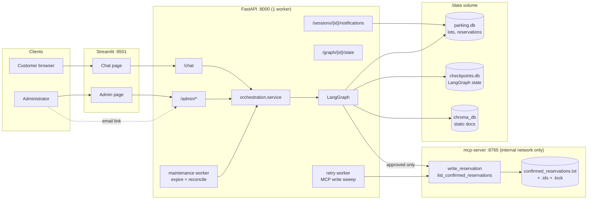
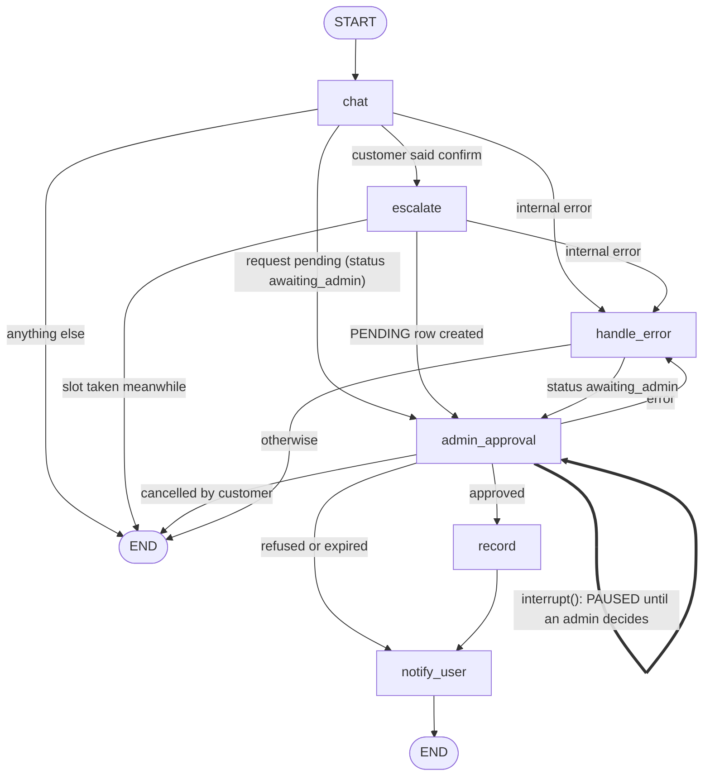
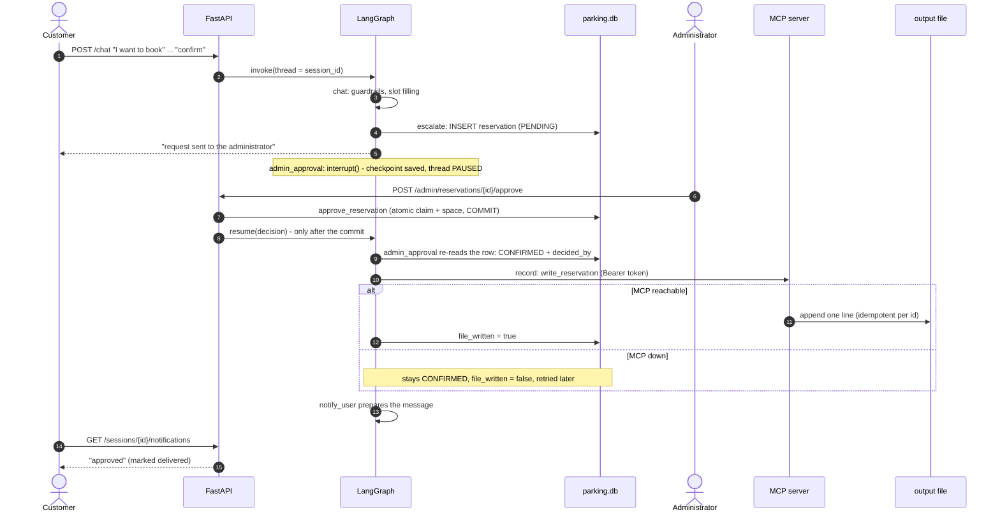
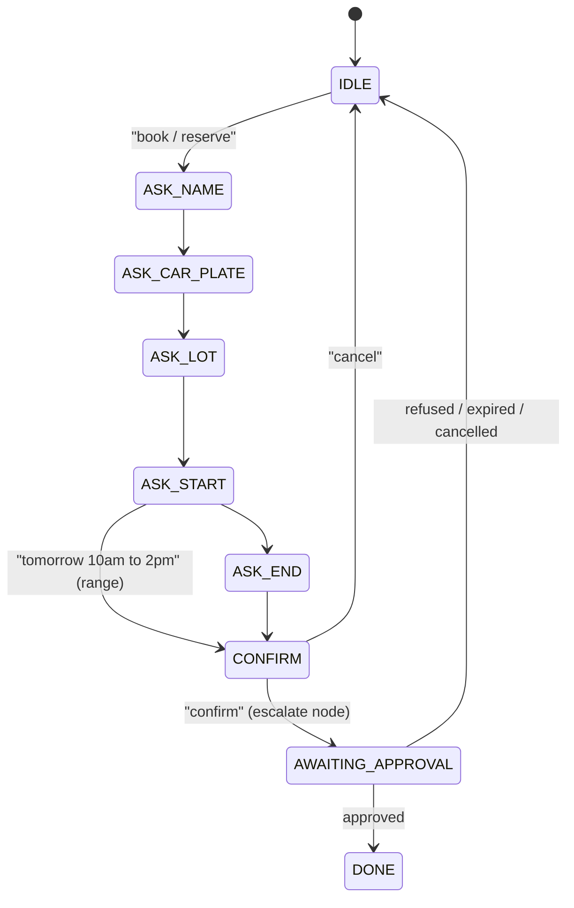

# CityPark RAG Chatbot - Architecture (Stage 4)

One FastAPI process runs a **LangGraph** that orchestrates the whole booking journey: guard the
message, answer it (RAG / SQL) or collect a reservation, escalate it to an administrator, **pause**
until a human decides, then record the approved reservation through an **MCP server** and notify the
customer. This document explains how the parts fit, why they are built the way they are, and what
happens when things fail.

- [1. System overview](#1-system-overview)
- [2. The LangGraph](#2-the-langgraph)
- [3. Agents](#3-agents)
- [4. The MCP server](#4-the-mcp-server)
- [5. Consistency and concurrency](#5-consistency-and-concurrency)
- [6. Failure and recovery](#6-failure-and-recovery)
- [7. Security model](#7-security-model)
- [8. Configuration](#8-configuration)
- [9. Deployment](#9-deployment)
- [10. API reference](#10-api-reference)
- [11. Testing and load testing](#11-testing-and-load-testing)
- [12. Limitations](#12-limitations)

---

## 1. System overview



| Component | Where | Role |
|---|---|---|
| API | `app/api` | HTTP surface; thin: each route calls `app/orchestration/service.py` |
| Orchestration | `app/orchestration` | LangGraph nodes, state, SQLite checkpointer, service facade |
| Customer bot ("Agent 1") | `app/chat` | intent routing, RAG, SQL answers, booking state machine |
| Admin agent ("Agent 2") | `app/agents/admin_agent.py` | LangChain tools, natural-language admin commands |
| Channels / bus | `app/agents/channels`, `bus.py` | how an escalation reaches the administrator |
| MCP server | `app/mcp_server` | separate process; appends approved reservations to a file |
| MCP client / writer | `app/agents/mcp_client.py`, `reservation_writer.py` | authenticated, retried, approval-gated export |
| Repository | `app/db/repository.py` | the only code that changes a reservation's status |
| Guardrails | `app/guardrails` | injection blocking, PII masking (input and output) |

---

## 2. The LangGraph



Source of truth: `app/orchestration/graph.py` (`build_graph`). `thread_id` is the chat `session_id`,
so every conversation has its own checkpointed state in `checkpoints.db`.

### Nodes

| Node | Wraps (no logic is duplicated) | Does |
|---|---|---|
| `chat` | `check_input` -> `router.handle` / `reservation.advance` -> `check_output` | One customer turn: guardrails, info answers (RAG or SQL), slot filling. Stops at the user's "confirm" (`advance(defer_confirm=True)`). |
| `escalate` | `reservation.finalize_confirmed` | Creates the `PENDING` row and sends it to every enabled channel (REST, email). |
| `admin_approval` | `interrupt()` | **The human in the loop.** Reads the database row first; pauses only while it is still `PENDING`. |
| `record` | `reservation_writer.export_approved` | MCP write. Runs only for an admin-approved row; a failure is marked for retry and the flow continues. |
| `notify_user` | `messages.build_user_message` | Prepares the customer text in `state.notification`; delivery stays with `/sessions/{id}/notifications`. |
| `handle_error` | - | Turns an internal failure into a safe reply (class names only are logged). |

### State (`app/orchestration/state.py`)

| Field | Meaning |
|---|---|
| `session_id` | conversation / thread id |
| `messages` | last 20 turns, **masked** text only (capped append reducer) |
| `intent`, `sources`, `guardrail_flags`, `answer` | the reply of the current turn (reset every turn) |
| `reservation` | snapshot of the booking slots (so a half-finished booking survives a restart) |
| `confirmed` | the customer said "confirm"; `escalate` must run |
| `reservation_id` | the `PENDING` / decided `LotReservation` this thread waits on |
| `status` | `idle`, `collecting`, `awaiting_admin`, `approved`, `refused`, `expired`, `cancelled`, `error` |
| `file_written` | the MCP write succeeded (reset when a new request is created) |
| `notification`, `errors` | text for the customer once decided; internal error markers |

The raw user message and the database session are **not** state: they travel in the run config
(`TurnContext`), so the checkpoint file never holds free text the PII guard has not masked.
The only raw personal data in a checkpoint is the booking-slot snapshot - the same data
`parking.db` stores for the reservation.

### Booking journey



### Where the human interrupt happens and how it resumes

`admin_approval` is the only pause. When it runs and the row is `PENDING` it calls `interrupt()`;
the run stops and the state is checkpointed. The thread is resumed by exactly one function,
`service.sync_decision`, which reads the **committed** decision from the database and calls
`graph.invoke(Command(resume=...))`. It is invoked by:

- the REST approve/refuse routes and the one-click email links (via `service.decide`),
- `POST /admin/chat` after the admin agent committed the decision,
- the expiry sweep (`EXPIRED`) and the reconcile sweep (see section 6).

The LLM is never on that path. After resuming, the node trusts the **database**, not the resume
value: it reports "approved" only if the row is `CONFIRMED` with an admin's `decided_by` /
`decided_at`. A bare or forged resume therefore yields `status=error` and records nothing.

A customer message while waiting starts a new run that re-enters `admin_approval` and pauses
again, so chatting never drops the pending approval.

### Booking state machine (inside `chat`)



A message may fill several slots at once ("book for Jane Doe, ABC-1234, tomorrow 10am to 2pm"); the
machine then skips ahead. At every step the customer can type `cancel`.

---

## 3. Agents

### Agent 1 - customer bot (`app/chat`)

`router.classify` asks the LLM for a JSON intent and falls back to a keyword classifier on any
failure, so it works offline with the `MockLLMClient`. Intents: `STATIC_INFO` (RAG over ChromaDB),
`DYNAMIC_INFO` (SQL facts fed to the LLM with a "use only these numbers" prompt), `RESERVATION`,
`SMALL_TALK`, `OUT_OF_SCOPE`. `reservation.py` validates every slot (plate format, opening hours,
>= 60 min ahead, >= 30 min duration, availability and overlap) before showing the summary.
English only: dates are parsed with `languages=["en"]` (without it dateparser scanned ~600 locales
per call - about 1 s of CPU per chat turn under load).

### Agent 2 - admin agent (`app/agents/admin_agent.py`)

Three phases: (1) `generate_notification` - grounded in tool results (`get_reservation_details`,
`check_lot_availability`), the LLM only writes prose; (2) `parse_decision` - a **deterministic
keyword gate runs before any LLM call**: no explicit approve/refuse keyword means a clarification
question, never a decision; (3) `execute_decision` - calls `record_admin_decision`, which uses the
repository. `write_reservation` is deliberately not in the LLM-facing `TOOLS` list.

### Channels and bus

`ChannelRegistry.send_all` fans an escalation out to `RestChannel` (always: stores an
`ApprovalRequest` row the admin panel lists) and `EmailChannel` (optional, SMTP, signed single-use
action links). `InProcessBus` is the agent-to-agent interface (`send_escalation`, `get_decision`,
`mark_notified`) behind `get_bus()`, replaceable by a queue.

---

## 4. The MCP server

A separate process (`scripts/run_mcp_server.py`, FastMCP over streamable-http, stateless JSON) that
owns the output file. Tools: `write_reservation(...)` and read-only `list_confirmed_reservations`.
`GET /health` is the only unauthenticated route.

File format (`data/output/confirmed_reservations.txt`):

```
Name | Car Number | Reservation Period | Approval Time
jaya kumari | TS09AB1234 | 2026-11-04 14:00 - 17:00 | 2026-11-03 11:30:00
```

**Write path**: validate (Pydantic; `|`, control characters and leading `= + - @` are rejected) ->
thread lock + OS file lock (`msvcrt` / `fcntl`) -> look the id up in `<file>.ids` -> append the line,
`fsync` -> append `<id> <sha256(line)>` to `.ids`, `fsync`.

**Idempotency**: same id + same content -> `duplicate` (nothing written); same id + *different*
content -> `conflict` (nothing written, never reported as success). A line truncated by a crash is
terminated before the next append. A crash between the line and its id could allow one duplicate on
retry; a reservation is never lost.

**Client side** (`mcp_client.py`): refuses anything that is not admin-approved (`is_admin_approved`),
retries with exponential backoff, and classifies outcomes (`OK`, `BLOCKED`, `DISABLED`, `PERMANENT`,
`TRANSIENT`) so a retry sweep stops on an outage but skips one rejected row.
`reservation_writer.export_approved` flips `file_written=True` on success; the row of an
unwritten approval *is* the retry marker, swept every `MCP_RETRY_INTERVAL_SECONDS` and by
`scripts/retry_pending_writes.py`.

Performance note (measured, see the load report): the SDK's default HTTP client builds a TLS
context on every call (~470 ms of CPU on the test machine), so a write from the API costs ~0.5 s
even though the server needs a few milliseconds.

---

## 5. Consistency and concurrency

These rules came out of the load test and the review; each has a regression test in
`tests/test_review_hardening.py`.

| Hazard | Protection |
|---|---|
| Two admins (or a double click) decide the same request | `approve/refuse_reservation` run under `repository.decision_lock` **and** claim the row with `UPDATE ... WHERE status='pending'`; exactly one wins, the other gets a 409 |
| Two approvals take the last space | The space is taken with `UPDATE ... SET available_spaces = available_spaces - 1 WHERE available_spaces > 0`, in the same transaction as the claim |
| Overlapping bookings exceed capacity | The overlap check runs inside the same lock |
| Approval vs expiry vs customer cancel on one row | all three use the same lock and the same atomic claim |
| A chat turn and an admin resume on the same checkpoint | per-session lock in `service.py` (`session lock -> decision_lock`, never the reverse) |
| Two paths export the same approval | `export_approved` refreshes the row and the MCP server is idempotent per id |

Measured before the fix (12 concurrent approvals for a 5-space lot): 12 confirmed, counter off by
several. After: see `docs/load_test_report.md`. The lock is process-local; the atomic SQL guards the
status and the counter across processes, but the overlap check is not. The app is deployed as one
worker anyway, because booking state lives in process memory.

---

## 6. Failure and recovery

| Crash / failure point | What survives | Recovery | Test |
|---|---|---|---|
| Process dies while a request is pending | `PENDING` row + checkpoint | thread still paused; the next admin decision resumes it; the customer's next message restores the waiting state | `test_restart_resumes_the_paused_booking_from_the_sqlite_checkpoint` |
| Decision committed, process dies before the resume | decided row, paused thread | `reconcile_decided` (startup and every sweep) resumes it; the customer's next turn also reconciles lazily | `test_crash_after_decision_commit_before_graph_resume_is_healed_by_reconcile` |
| Dies after the `PENDING` row is created, before the checkpoint | row, stale "CONFIRM" snapshot | the database wins: the waiting state is rebuilt from the row (`recover_pending_session`) | `test_crash_between_pending_row_and_checkpoint_recovers_from_the_database` |
| `checkpoints.db` lost or replaced | `parking.db` | waiting state rebuilt from the `PENDING` row, a new pause is created on the same row | `test_losing_the_whole_checkpoint_database_does_not_lose_a_pending_approval` |
| MCP server down at approval | `CONFIRMED`, `file_written=false` | flow continues, customer notified; retry worker / script writes it later; idempotent | `test_mcp_down_marks_for_retry_and_the_flow_continues` |
| Admin never answers | `PENDING` row | after `APPROVAL_TTL_HOURS` the sweep marks it `EXPIRED`, resumes the thread, the customer is told | `test_admin_who_never_replies_expires_the_request` |
| Customer withdraws while waiting | - | atomic `CANCELLED`; a later admin approve gets 409; the thread ends | `test_customer_cancel_while_waiting_ends_the_thread_and_blocks_approval` |
| An exception inside a node | - | `handle_error` replies safely and logs the class name; a pending approval is never abandoned | `test_chat_node_failure_goes_to_handle_error_with_a_safe_reply` |

The checkpoint is a cache; the database is the authority. Nothing is ever lost because a
checkpoint was.

---

## 7. Security model

- **Admin API**: `X-Admin-Key` compared with `hmac.compare_digest`; 503 if the key is not
  configured, 401 if missing, 403 if wrong. The key is never logged; audit columns store
  `api:` + a hash, not part of the key.
- **Email links**: signed (itsdangerous), expiring, single-use. **If `EMAIL_TOKEN_SECRET` is empty
  or the shipped placeholder, links are neither created nor accepted** (the placeholder is public, so
  a token signed with it would be forgeable). A warning is logged at start-up.
- **PII**: names/plates are masked in logs, LLM prompts and checkpoint messages; plates are masked in
  admin views and in `/graph/{id}/state`. Exception messages are not logged (class name only), because
  they can quote customer data.
- **Access log**: uvicorn runs with `--no-access-log`; its access line would print the full URL
  including `?token=...` of the email links. The app logs method, path and status itself.
- **Public endpoints**: `/chat`, `/lots`, `/health`, `/reset-session`, `/reservations/{id}/status`,
  `/sessions/{id}/notifications`. The session id acts as the capability for the last two and for
  `/reset-session`; use unguessable ids (the bundled UI uses UUIDs). The Stage-1 listing
  `/reservations/` and `/reservations/{id}` (names, plates) now require the admin key.
- **MCP server**: bearer token on every route but `/health`, constant-time compare, per-client rate
  limit applied before authentication, no client-chosen paths, no PII in logs, internal Docker
  network with no published port, read-only root filesystem, all capabilities dropped.
- **Secrets**: nothing is hard-coded. `MCP_API_KEY` and `ADMIN_API_KEY` have no default in compose or
  Terraform; the load test generates its keys per run.

---

## 8. Configuration

All settings come from environment variables or `.env` (see `.env.example`).

| Variable | Default | Purpose |
|---|---|---|
| `OPENAI_API_KEY` / `OPENAI_API_BASE` / `OPENAI_MODEL` | placeholder | LLM; a placeholder key selects the offline `MockLLMClient` |
| `DATABASE_URL` | `sqlite:///./parking.db` | business data |
| `CHROMA_PERSIST_DIR` / `CHROMA_COLLECTION` | `./chroma_db` / `parking_static` | static documents |
| **`CHECKPOINT_DB`** | `./checkpoints.db` | LangGraph SQLite checkpoints (`/data/checkpoints.db` in Docker) |
| `APPROVAL_TTL_HOURS` | `24` | unanswered requests expire after this long |
| `APPROVAL_EXPIRY_ENABLED` / `APPROVAL_EXPIRY_CHECK_SECONDS` | `true` / `300` | maintenance sweep (expire + reconcile) |
| **`ADMIN_API_KEY`** | required | protects `/admin/*`, `/graph/*`, Stage-1 listings |
| **`EMAIL_TOKEN_SECRET`** | placeholder = links disabled | signs one-click links |
| `ADMIN_EMAIL_ENABLED`, `SMTP_*`, `ADMIN_EMAIL`, `EMAIL_FROM`, `ADMIN_API_BASE_URL` | off / local | email channel |
| **`MCP_API_KEY`** | empty = export off | bearer token shared by API and MCP server (>= 16 chars) |
| `MCP_HOST` / `MCP_PORT` / `RESERVATIONS_FILE` / `MCP_RATE_LIMIT_PER_MINUTE` | `127.0.0.1` / `8765` / `data/output/...` / `120` | MCP server |
| `MCP_SERVER_URL` / `MCP_EXPORT_ENABLED` / `MCP_CLIENT_*` / `MCP_RETRY_INTERVAL_SECONDS` | see `.env.example` | MCP client and retry worker |

---

## 9. Deployment

**Run order** (each step needs the previous ones):

1. configuration (`.env`) 2. database + vector store (`seed_db`, `migrate_stage2`, `ingest`)
3. **MCP server** 4. **API** (creates tables, starts the retry and maintenance workers)
5. **UI**. The API works without the MCP server (approvals succeed, `file_written=false`, the retry
worker catches up) and without the UI; the UI needs the API.

**Docker Compose** starts `api`, `ui` and `mcp-server`. `parking_data` (mounted at `/data`) holds
`parking.db`, `chroma_db` **and `checkpoints.db`**; `mcp_output` holds the reservations file. The MCP
server sits on an `internal: true` network shared only with the API. `api` has a health check,
`ui` waits for it.

**Terraform** (`infra/`, kreuzwerker/docker provider) builds the same topology; `checkpoint_db` must be
under `/data/`, `mcp_api_key` is required (>= 24 chars, sensitive).

Run only **one API worker** (`uvicorn` without `--workers`): booking state is held in process memory
and SQLite is the store.

---

## 10. API reference

Generated from the running app (`app.routes`); "admin" = `X-Admin-Key` header.

| Method | Path | Auth | Purpose |
|---|---|---|---|
| POST | `/chat` | public | one customer turn on the graph |
| GET | `/health` | public | liveness |
| GET | `/lots` | public | live availability and prices |
| POST | `/reset-session` | public (session id) | forget a conversation (checkpoints + booking state) |
| GET | `/reservations/{id}/status` | public | approval status of a reservation |
| GET | `/sessions/{session_id}/notifications` | public (session id) | fetch and mark delivered the admin decisions |
| GET | `/reservations/`, `/reservations/{id}` | admin | Stage-1 reservations (names, plates) |
| GET | `/admin/verify` | admin | key check |
| GET | `/admin/reservations/pending` | admin | pending requests |
| GET | `/admin/reservations/history` | admin | decided requests |
| GET | `/admin/reservations/{id}` | admin | one reservation |
| POST | `/admin/reservations/{id}/approve` | admin | approve (resumes the graph, records to the file) |
| POST | `/admin/reservations/{id}/refuse` | admin | refuse with a reason |
| POST | `/admin/chat` | admin | natural-language decision via the admin agent |
| GET | `/admin/approve?token=` / `/admin/refuse?token=` | signed token | one-click email links |
| GET | `/graph/{session_id}/state` | admin | debug view of a checkpointed thread |

Status codes of the decision routes: 200 decided, 404 unknown id, 409 not `PENDING` (including a lost
race or a second click), 422 invalid input / auto-refused for lack of space, 401/403 auth.

---

## 11. Testing and load testing

```bash
python -m pytest --cov=app --cov-report=term-missing        # whole suite; CI requires >= 85 %
python -m pytest tests/integration -q                        # full API pipeline only
python -m ruff check app/ tests/ load/ scripts/run_mcp_server.py scripts/retry_pending_writes.py --ignore E501,E402
```

- `tests/test_orchestration_*.py` - state, node safety, graph flows, API surface.
- `tests/integration/test_pipeline.py` - chat -> escalate -> decision -> file, with the real
  MCP store behind a mocked transport, including a concurrent users-and-admins race.
- `tests/test_review_hardening.py` - races, crash windows, auth gaps, log hygiene.
- Tests use mocked LLM/MCP and tmp SQLite files, and dispose connections in fixtures.

```bash
pip install -r load/requirements-load.txt                     # matplotlib, for the chart only
python load/load_test.py run --label after                    # starts its own API + MCP servers (~6 min)
python load/load_test.py report                               # writes docs/load_test_report.md + chart
```

See `docs/load_test_report.md` for the method, numbers and findings.

---

## 12. Limitations

- **One worker, in-memory booking state.** Scaling out needs the booking state and the locks moved
  to a shared store (Redis/Postgres) and an advisory lock for the overlap check.
- **`/chat` blocks the event loop.** The route is `async def` but the work is synchronous (guardrails,
  RAG, SQLite, checkpoints), so concurrent users are served one at a time: throughput is bounded by
  per-turn CPU (see the load report). Making it a plain `def` route (thread pool) is the first
  optimisation to try; it needs the same locks reviewed.
- **Checkpoints are never pruned** (about 25 KB per turn). Plan a retention job for long-lived
  deployments.
- **Session ids are capabilities.** Anyone who knows one can read/consume that session's
  notifications or reset it. Keep them random; there is no per-user login for customers.
- **No rate limiting** on `/chat` or the admin routes (only the MCP server limits requests).
- **MCP**: the output file is an append-only log (cancelling later does not remove a line); names and
  plates are in clear text; plain HTTP - keep it on loopback / the internal network; one shared key; one
  writer host; the SDK client costs ~0.5 s per write.
- **Email links** are disabled until `EMAIL_TOKEN_SECRET` is set.
- **English only** (date parsing and prompts).
- Docker images were not built or started in the environment where this stage was written (no
  Docker daemon); compose and Terraform were validated statically and CI builds the image.
