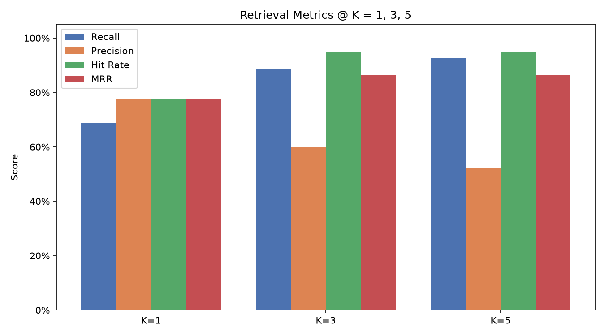
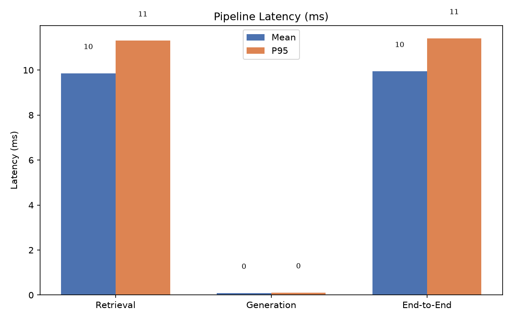
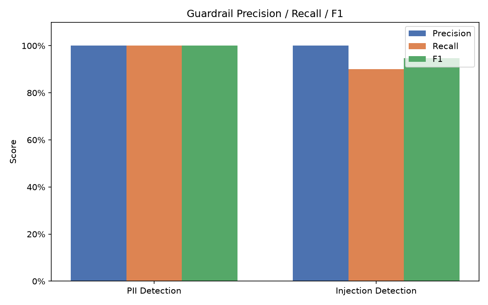
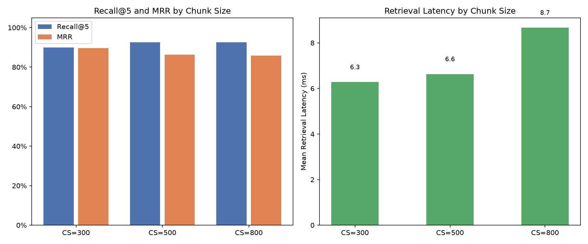

# CityPark RAG Chatbot — Evaluation Report

**Generated:** 2026-10-30T16:27:46  
**Dataset:** 40 questions  |  Guardrail: 30 items  
**Embedding model:** all-MiniLM-L6-v2  |  **Chunk size (default):** 500  |  **Overlap:** 80

---

## 1. Retrieval Quality

### Metrics at K = 1, 3, 5

| Metric | @K=1 | @K=3 | @K=5 |
|--------|-----:|-----:|-----:|
| **Recall** | 68.8% | 88.8% | 92.5% |
| **Precision** | 77.5% | 60.0% | 52.0% |
| **Hit Rate** | 77.5% | 95.0% | 95.0% |
| **Mrr** | 77.5% | 86.2% | 86.2% |

### Per-Category Hit Rate @ 5

| Category | Hit Rate@5 |
|----------|----------:|
| accessibility | 100.0% |
| booking | 100.0% |
| cancellation | 100.0% |
| ev_charging | 100.0% |
| faq | 100.0% |
| location | 100.0% |
| out_of_scope | 0.0% |
| payment | 100.0% |
| rules | 100.0% |
| security | 100.0% |
| small_talk | 0.0% |

**Analysis:** Overall Recall@5 is 92.5%, which means the relevant source document is retrieved in the top-5 results for 92.5% of queries. Hit Rate@5 of 95.0% confirms broad coverage. MRR of 86.2% indicates the first relevant result appears near the top on average.

---

## 2. Answer Quality

Evaluated on 20 sampled questions using the offline MockLLM (sentence extraction from top chunks).

| Metric | Score |
|--------|------:|
| Keyword Coverage (vs reference) | 26.3% |
| Semantic Similarity (vs reference) | 46.8% |
| Query-Answer Relevance | 49.5% |

**Analysis:** MockLLM extracts verbatim sentences from retrieved chunks; keyword coverage reflects vocabulary overlap with the reference. Semantic similarity captures meaning alignment. With a real LLM, synthesised answers would score higher on both metrics.

---

## 3. Performance

### Latency (milliseconds)

| Stage | Mean (ms) | P95 (ms) |
|-------|----------:|---------:|
| Retrieval | 9.86 | 11.31 |
| Generation | 0.09 | 0.11 |
| End-to-End | 9.95 | 11.41 |

### Throughput (20 concurrent workers)

- Wall time: **0.37 s**
- Throughput: **54.09 requests/s**

**Analysis:** Retrieval dominates latency because it involves embedding computation and ChromaDB ANN search. Generation with MockLLM is near-zero; with a real LLM the generation stage will be ~500–2000 ms depending on model and token count.

---

## 4. Guardrail Evaluation

### PII Detection

| Metric | Score |
|--------|------:|
| Precision | 100.0% |
| Recall    | 100.0% |
| F1        | 100.0% |

TP=10  FP=0  FN=0  TN=10

### Injection Detection

| Metric | Score |
|--------|------:|
| Precision | 100.0% |
| Recall    | 90.0% |
| F1        | 94.7% |

TP=9  FP=0  FN=1  TN=10

**Analysis:** Presidio + custom recognisers achieve strong PII recall on structured entity types (emails, phones, cards). Precision may be slightly lower due to context-free NER over-triggering PERSON on parking-domain words. Injection detection relies on regex patterns and has high precision; novel jailbreak phrasings not in the pattern list may be missed.

---

## 5. Chunk Size Comparison

Retrieval metrics at K=5 for each chunk size (in-memory re-ingestion):

| Chunk Size | Overlap | Recall@5 | Precision@5 | MRR | Mean Ret. Latency (ms) |
|------------|--------:|---------:|------------:|----:|-----------------------:|
| 300 | 48 | 90.0% | 54.5% | 89.6% | 6.28 |
| 500 | 80 | 92.5% | 51.5% | 86.2% | 6.63 |
| 800 | 128 | 92.5% | 50.0% | 85.8% | 8.67 |

---

## 6. Recommendation

**Best configuration: chunk_size=500, k=5**

Chunk size **500** achieves the highest Recall@5 (92.5%) and MRR (86.2%) among the tested configurations. This aligns with the current default of 500. Smaller chunks (300) improve precision but miss multi-sentence answers that span paragraph boundaries. Larger chunks (800) include more context per chunk but dilute the relevance signal. K=5 is recommended to balance recall and the amount of context sent to the LLM.

### Summary Table

| Parameter | Default | Recommended |
|-----------|---------|-------------|
| `chunk_size` | 500 | 500 |
| `chunk_overlap` | 80 | 80 |
| `retrieval_top_k` | 5 | 5 |

---
*Report generated automatically by `scripts/run_eval.py`.*