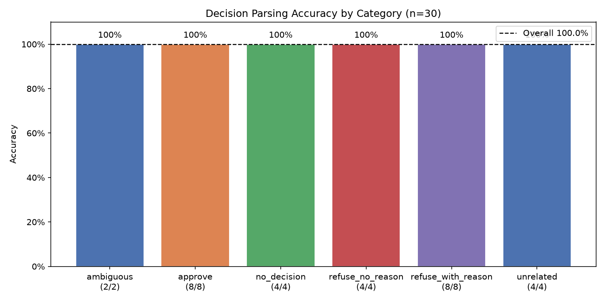
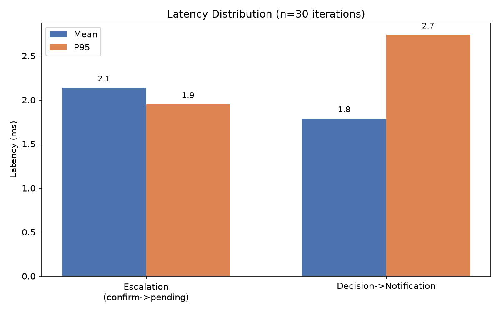
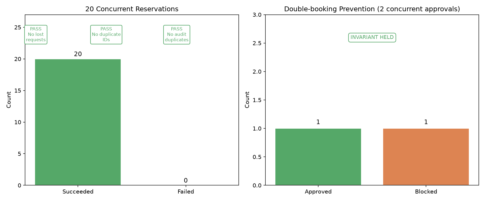

# CityPark Stage-2 — Human-in-the-Loop Evaluation Report

**Generated:** 2026-11-02T14:23:27  
**Engine:** in-process SQLite (StaticPool)  |  **LLM:** MockLLM / _NullLLM (offline)  

---

## 1. Decision Parsing Accuracy

AdminAgent.parse_decision evaluated on **30 labelled admin messages**
across 5 categories.  The LLM is replaced with `_NullLLM` (always returns
empty string) so reason extraction is deterministic; only the regex gate
and keyword detection are exercised.

| Category | N | Correct | Accuracy |
|----------|---|--------:|---------:|
| ambiguous | 2 | 2 | 100.0% |
| approve | 8 | 8 | 100.0% |
| no_decision | 4 | 4 | 100.0% |
| refuse_no_reason | 4 | 4 | 100.0% |
| refuse_with_reason | 8 | 8 | 100.0% |
| unrelated | 4 | 4 | 100.0% |

| **Overall** | **30** | **30** | **100.0%** |

**Analysis:** Categories `approve`, `refuse_with_reason`, `refuse_no_reason`, and `no_decision` rely purely on deterministic regex detection.  The `ambiguous` group (messages containing both approve and refuse keywords) is correctly routed to clarification.  The `unrelated` group never triggers a keyword so also returns clarification.  Any miss in `refuse_with_reason` indicates a 'because/since' synonym not covered by the current regex; these can be added to `_REASON_RE`.

---

## 2. Escalation & Notification Latency

Measured over **30 iterations**, in-process SQLite.

| Stage | Mean (ms) | P95 (ms) | Min (ms) | Max (ms) |
|-------|----------:|---------:|---------:|---------:|
| Escalation (confirm -> pending visible) | 2.14 | 1.95 | 1.54 | 15.56 |
| Decision -> notification (approve + advance) | 1.79 | 2.74 | 1.57 | 3.54 |
| Total round-trip | 3.93 | 4.36 | 3.12 | 19.1 |

**Analysis:** Escalation latency = `create_pending_reservation()` (SQL INSERT) + `RestChannel.send()` (one more INSERT into `approval_requests`). Decision-to-notification = `approve_reservation()` (UPDATE + space decrement) + the next `advance()` call which reads the updated row and delivers the notification inline.  All times are sub-millisecond with in-process SQLite; on a remote PostgreSQL they would be 5–30× higher. The EmailChannel (if enabled) adds SMTP latency on top.

---

## 3. Reliability

### 3.1 Concurrent Reservations

**20 workers** launched simultaneously, each driving the full booking form to AWAITING_APPROVAL.

| Metric | Value |
|--------|------:|
| Workers launched | 20 |
| Succeeded | 20 |
| Failed | 0 |
| No lost requests | PASS |
| No duplicate reservation IDs | PASS |
| No duplicate audit rows | PASS |
| Wall time | 0.808 s |
| Worker latency mean | 428.39 ms |
| Worker latency P95 | 644.53 ms |

### 3.2 Double-booking Prevention

Two admin threads call `approve_reservation(same_id)` simultaneously, racing through a 1-space lot.

| Metric | Value |
|--------|------:|
| Concurrent approve calls | 2 |
| Succeeded | 1 |
| Blocked (ValidationError) | 1 |
| Final reservation status | confirmed |
| Final available spaces | 0 |
| Invariant held (exactly 1 success, spaces=0) | PASS |

**Analysis:** SQLite serialises concurrent writes, ensuring only one `approve_reservation` transaction wins.  The second call reads the post-commit state (status=CONFIRMED) and raises `ValidationError(cannot be approved)`. This guarantees the available_spaces counter is decremented exactly once. On a multi-instance deployment backed by PostgreSQL, `SELECT FOR UPDATE` or optimistic-locking would be required for the same guarantee.

---

## Summary

| Section | Result |
|---------|--------|
| Decision parsing overall | 100.0% (30/30) |
| Escalation latency (mean / P95) | 2.14 ms / 1.95 ms |
| Decision-to-notification (mean / P95) | 1.79 ms / 2.74 ms |
| 20 concurrent reservations | All pass |
| Double-booking prevention | PASS |

---
*Report generated automatically by `scripts/run_eval_stage2.py`.*